# Agentic AI Design Patterns

A concise guide to common agentic AI design patterns, based on the [Google Cloud Architecture Center](https://docs.cloud.google.com/architecture/choose-design-pattern-agentic-ai-system).

## Table of Contents

- [Single-Agent System](#single-agent-system)
- [Multi-Agent System](#multi-agent-system)
- [Sequential Pattern](#sequential-pattern)
- [Parallel Pattern](#parallel-pattern)
- [Loop Pattern](#loop-pattern)
- [Review and Critique Pattern](#review-and-critique-pattern)
- [Iterative Refinement Pattern](#iterative-refinement-pattern)
- [Coordinator Pattern](#coordinator-pattern)
- [Hierarchical Task Decomposition](#hierarchical-task-decomposition-pattern)
- [Swarm Pattern](#swarm-pattern)
- [ReAct Pattern](#reason-and-act-react-pattern)
- [Human-in-the-Loop Pattern](#human-in-the-loop-pattern)
- [Custom Logic Pattern](#custom-logic-pattern)

---

## Single-Agent System

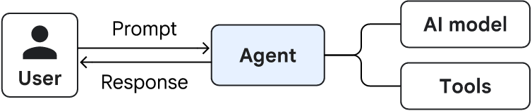

**Usage**
- Multi-step tasks requiring external tools or data.
- Good starting point for building an AI agent.

**Key characteristics**
- One agent handles the task.
- Uses a model, tools, and system instructions.

**Related pattern:** ReAct

---

## Multi-Agent System

**Usage**
- Complex problems requiring multiple specialized agents.
- Tasks that benefit from delegation and collaboration.

**Key considerations**
- Evaluation and reliability.
- Security and access control.
- Operational cost and orchestration complexity.

**Common patterns:** Sequential, Parallel, Coordinator, Swarm.

---

## Sequential Pattern

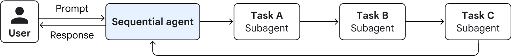

**Usage**
- Predictable workflows with predefined steps.
- Each step depends on the previous step's output.

**Key characteristics**
- Agents execute in a fixed order.
- Simple to manage and evaluate.
- Less flexible when the workflow changes.

---

## Parallel Pattern

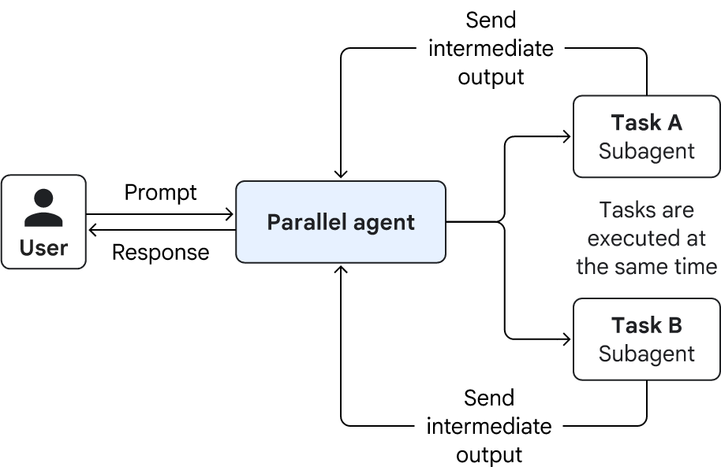

**Usage**
- Independent subtasks that can run simultaneously.
- Gathering information from multiple sources.

**Key characteristics**
- Multiple agents work concurrently.
- Results are combined into a final output.
- Can reduce latency but increase cost.

---

## Loop Pattern

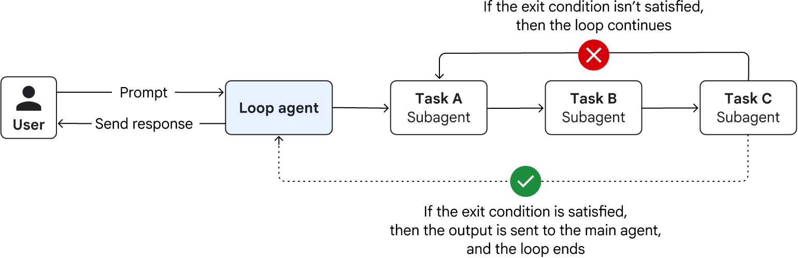

**Usage**
- Repeated tasks requiring checks or self-correction.
- Workflows that continue until a condition is met.

**Key characteristics**
- Repeats a predefined sequence of steps.
- Requires a clear exit condition.
- A maximum iteration limit helps prevent infinite loops.

---

## Review and Critique Pattern

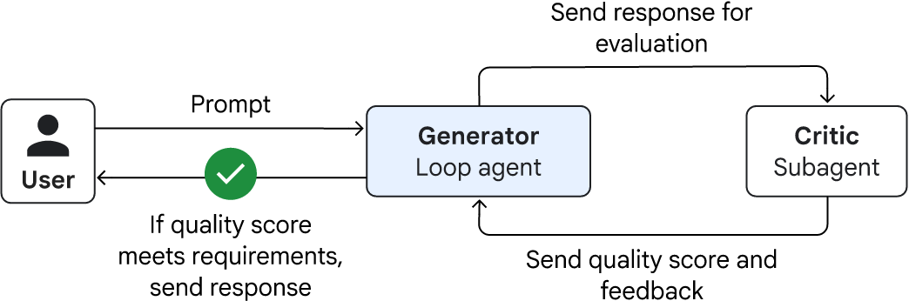

**Usage**
- Outputs requiring additional verification.
- Code generation, content validation, and quality checks.

**Key characteristics**
- A generator produces the initial result.
- A critic evaluates the result against defined criteria.
- Feedback can trigger revisions.

---

## Iterative Refinement Pattern

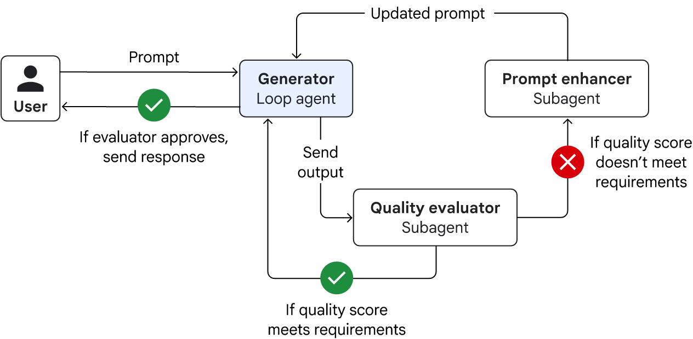

**Usage**
- Complex outputs that are difficult to produce in one attempt.
- Writing, planning, and debugging tasks.

**Key characteristics**
- Repeatedly improves an existing result.
- Uses feedback or quality criteria.
- Requires a stopping condition and iteration limit.

---

## Coordinator Pattern

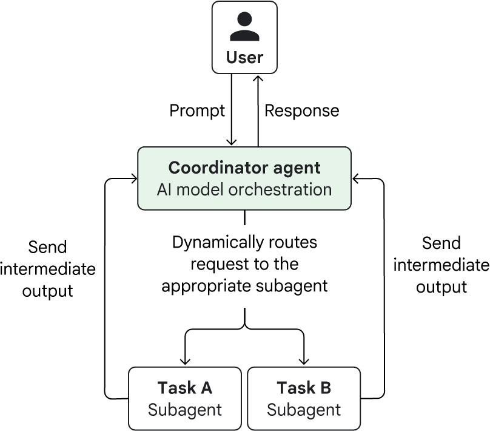

**Usage**
- Requests that require dynamic task routing.
- Workflows involving agents with different specialties.

**Key characteristics**
- A central agent analyzes the request.
- Tasks are delegated to specialized agents.
- Flexible orchestration can increase latency and cost.

---

## Hierarchical Task Decomposition Pattern

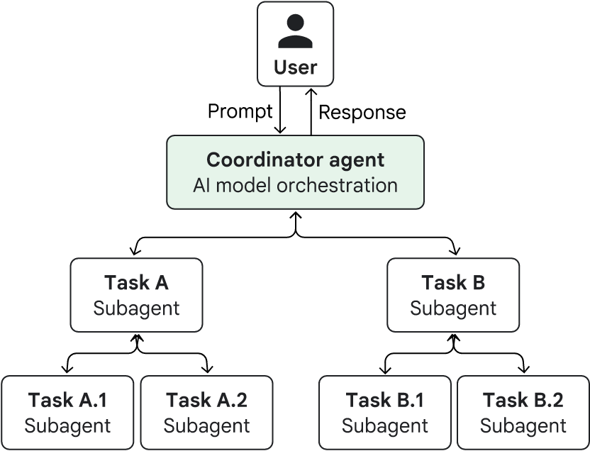

**Usage**
- Large, ambiguous, multi-step problems.
- Research, planning, and complex analysis.

**Key characteristics**
- A top-level agent decomposes the main task.
- Subagents handle smaller tasks or delegate further.
- Supports complex planning but increases orchestration complexity.

---

## Swarm Pattern

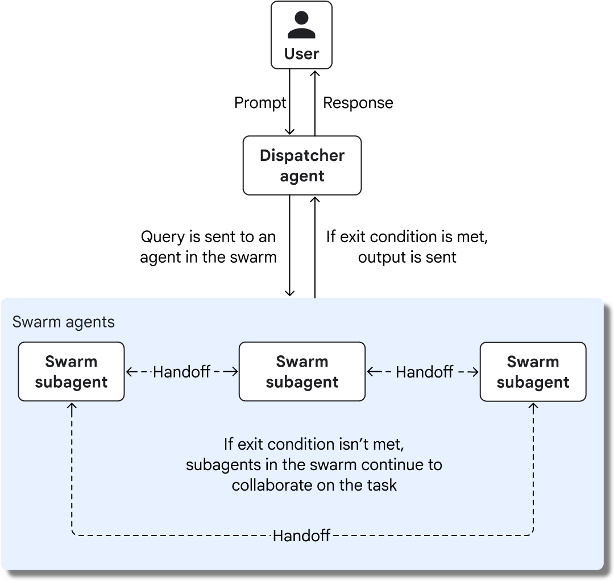

**Usage**
- Complex problems benefiting from collaboration and debate.
- Tasks requiring multiple perspectives and iterative improvement.

**Key characteristics**
- Specialized agents communicate and exchange findings.
- Agents can hand off tasks to one another.
- Requires explicit stopping conditions and careful cost management.

---

## Reason and Act (ReAct) Pattern

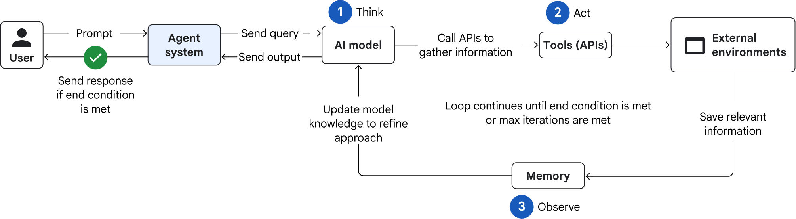

**Usage**
- Dynamic tasks requiring planning and tool usage.
- Tasks where new observations influence the next action.

**Key characteristics**
- **Reason:** Determine the next step.
- **Act:** Execute a tool or action.
- **Observe:** Process the result and decide what to do next.

The cycle continues until the task is complete or a stopping condition is reached.

---

## Human-in-the-Loop Pattern

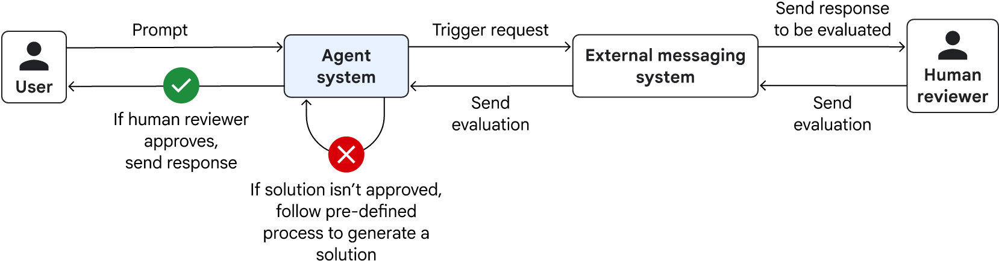

**Usage**
- High-stakes or sensitive decisions.
- Actions requiring human approval or judgment.

**Key characteristics**
- The agent pauses at a defined checkpoint.
- A human reviews, corrects, or approves the result.
- Execution resumes after the required intervention.

---

## Custom Logic Pattern

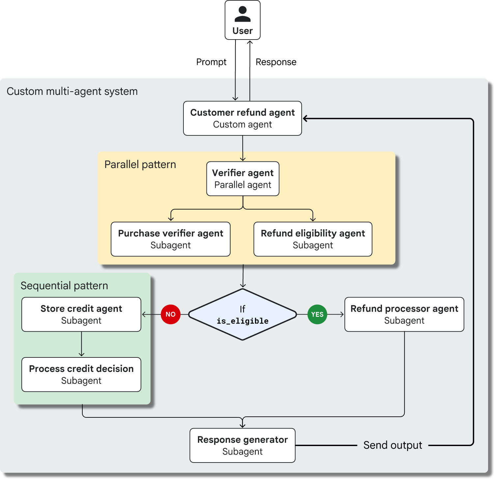

**Usage**
- Workflows that do not fit a predefined pattern.
- Complex processes with conditional branches.

**Key characteristics**
- Custom code controls the workflow.
- Combines rules, conditions, and agent reasoning.
- Offers flexibility but requires more development and testing.

---

## Reference

- [Google Cloud — Choose a design pattern for your agentic AI system](https://docs.cloud.google.com/architecture/choose-design-pattern-agentic-ai-system)
